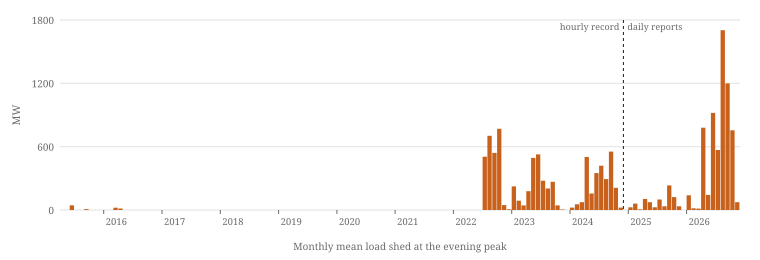
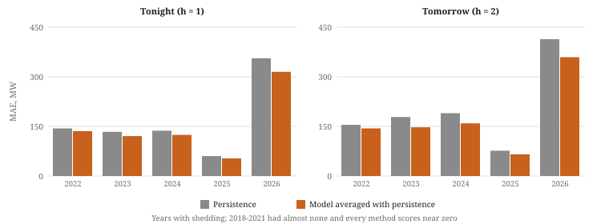
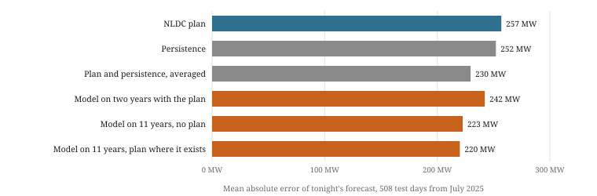

# Will There Be Load Shedding Tonight? Forecasting Evening-Peak Load Shedding in Bangladesh Against the Operator's Own Plan

*Talha Yaseer Abeer. Draft, 22 November 2026. All numbers come from scripts and result files in the public repository (Section IX).*

---

## Abstract

Load shedding is a daily operating tool in supply-constrained power systems, and the question households and industry ask is whether it will happen tonight. We build an 11.5-year daily series of evening-peak load shedding for Bangladesh (April 2015 to November 2026, 3,607 labelled days) by splicing the transmission operator's hourly record to the National Load Dispatch Centre's (NLDC's) daily reports, which agree exactly where they overlap. We then forecast tonight's and tomorrow's evening-peak shedding from only the information available at 11:00 on the day, retraining monthly and testing on 2,642 days from 2018 to 2026. Persistence (tonight equals last night) is a strong baseline, and gradient-boosted trees alone only tie it. Averaging the trees with persistence reduces the mean absolute error by 10 % for tonight (94 against 104 MW; 95 % CI 6–16 MW) and by 14 % for tomorrow (111 against 128 MW), and the trees rank shedding days better (AUC 0.95 against 0.91 tonight, 0.94 against 0.88 tomorrow). On the 508 days for which NLDC published a plan, the operator's plan named only 37 % of the evenings that had shedding; our model has a mean error of 220 MW against 257 MW for the plan (CI 9–65 MW better) and 252 MW for persistence. Once eleven years of history are used, the plan adds little information. The predictor is deployed as a web page that updates from each new report and lets the reader change its inputs.

**Index terms:** load shedding, supply shortfall, short-term forecasting, gradient boosting, persistence, Bangladesh, operator forecast benchmark.

---

## I. Introduction

Load shedding, the deliberate disconnection of consumers when supply cannot meet demand, is a daily operating tool in many supply-constrained power systems. In Bangladesh it returned at scale with the 2022 fuel crisis and again in 2026. For households, hospitals and factories the useful question is simple: will there be load shedding tonight, and how much?

The operator already answers it. Every morning the National Load Dispatch Centre (NLDC) of Power Grid Bangladesh PLC publishes a report with the previous day's operation and a plan for the day, including planned load shedding by zone. Yet machine-learning studies of load shedding rarely compare against this plan, and rarely restrict themselves to the information the operator had when it made it.

This paper makes that comparison. Its contributions are:

1. **A spliced 11.5-year daily series** of evening-peak load shedding for Bangladesh (April 2015 to November 2026, 3,607 labelled days), joining the operator's hourly record to its daily reports. On the 432 days the two overlap, their evening-peak values agree exactly.
2. **A forecasting protocol matched to the operator's information set:** at about 11:00 on day D the latest actuals are for D−1. We forecast tonight (D) and tomorrow (D+1), retraining monthly on earlier days only.
3. **The operator's published plan as a baseline,** alongside persistence, on 508 test days for which the plan exists.
4. **A deployed predictor** that updates from each new report and lets the reader change its inputs.
5. **An honest result:** averaged with persistence, a gradient-boosted model beats persistence by 10–14 % and the operator's plan by 14 %, but most of the skill comes from the recent history of shedding itself; on severe evenings persistence and the operator's plan remain the better guides.

## II. Related work

**Bangladesh.**
- Public datasets now cover daily demand, generation and load shedding extracted from the power board's PDF reports for 2019–2024 [1], and about 92,000 hourly records from the transmission operator's portal for 2015–2026 [2]; we use the latter.
- GridUQ-Net forecasts load shedding one hour ahead from the hourly record with a multi-task BiLSTM and conformal prediction intervals; for load shedding, persistence was the best point forecaster [3].
- A conference paper classifies whether shedding will occur with random forests and XGBoost [4].

**Elsewhere.**
- In South Africa, work has targeted the driver of load shedding, the unplanned capability loss factor of Eskom's fleet, with deep-learning ensembles [5], and short-term forecasts of unplanned outages [6].
- Load forecasting is mature and well benchmarked [7], [8], but it assumes demand is served; in supply-constrained systems the forecast that matters is of the demand that will *not* be served.

**Gap.** Among the studies we could read in full, none scores a load-shedding forecast against the operator's own published plan under the operator's information set, uses the operator's plant-by-plant reasons for missing capacity, or evaluates over a decade that contains several shortage regimes. This paper does.

## III. Data

### A. Sources

| Period | Source | Content |
|---|---|---|
| 17 Apr 2015 – 30 Dec 2024 | PGCB hourly record [2] | Generation, demand and load shedding each hour; fuel mix; imports. Rows marked by PGCB as the evening and day peaks. |
| 31 Dec 2024 – 20 Nov 2026 | NLDC daily reports [9] | Daily summary (peaks, energy served and not served, fuel mix, gas supplied, temperature); evening-peak demand and load shedding in nine zones; NLDC's plan for the next day, with planned load shedding and a plant-by-plant table of available capacity and the reason any is missing. |
| whole period | ERA5 via Open-Meteo [10] | Daily maximum temperature and humidity, averaged over Dhaka, Chattogram, Khulna and Rajshahi. |

We downloaded all 741 daily reports available in spreadsheet form and parsed them with a standard-library reader. Reports up to 22 January 2025 state energy in MWh rather than GWh and are rescaled.

### B. Splicing and cleaning

The target is load shedding at the evening-peak hour (substation end, MW). In the hourly record it is the value on the row PGCB marks *Evening_Peak*; in the reports it is the zone total at the evening peak. On the 432 overlapping days the two are identical (mean absolute difference 0.1 MW), as are evening-peak generation (0.9 MW) and demand. We therefore use the hourly record up to 30 December 2024 and the reports afterwards.

The hourly record contains entry errors (a dropped or doubled digit, e.g. 65,359 MW of shedding or 156,050 MW of demand). We remove shedding above 40 % of demand and demand or generation above 1.6 times its 15-day running median. Days without an evening-peak row are left unlabelled rather than filled.

### C. The series

- 3,607 labelled days; shedding at the evening peak on 970 of them, more than 1,000 MW on 137, and up to 4,395 MW (in 2022).
- Four regimes (Fig. 1): almost none from 2015 to 2021 (9 evenings in all); the fuel-crisis years 2022–2024 (shedding on 103–224 evenings a year, annual means of 197–227 MW); a quieter 2025 (68 MW); and a surge from April 2026 (592 MW mean in 2026, 1,704 MW in August).
- The regimes are what make the test hard: a model trained on calm years meets the 2022 crisis, and one trained on 2022–2025 meets the 2026 surge.

## IV. Forecasting problem

**Information set.** The report for day D is issued at about 11:00 on D+1 together with the plan for D+1. A forecast issued on the morning of day D therefore knows actuals up to D−1, NLDC's plan for D, the weather forecast and the calendar.

**Horizons.** *Tonight* (h = 1): the evening peak of day D. *Tomorrow* (h = 2): the evening peak of D+1, for which no plan has been published.

**Outputs.** The expected load shed (MW), the probability of any shedding, and the probability of more than 1,000 MW.

**Protocol.** Expanding window: at the start of each month the models are retrained on every earlier labelled day and tested on that month. The test period runs from January 2018, so the first models learn from 2.7 years.

## V. Methods

**Baselines.**
- *Persistence:* tonight equals last evening (for h = 2, the latest known evening).
- *7-day mean* of the latest known evenings.
- *NLDC's plan* (tonight only, from 2025).
- *NLDC's plan and persistence, averaged.*

**Inputs** (all known at the time of issue):
- the last seven evenings' shedding, its 7- and 30-day mean, maximum and frequency, and its ratio to demand;
- the latest day's shedding at the day peak, energy not served, evening and day-peak demand and generation, minimum generation, and the energy from gas, liquid fuel, coal and imports, with their 7- and 30-day trends;
- maximum temperature and humidity on the target day (ERA5 in the backtest, the forecast in deployment) and its change since the latest known day;
- calendar: day of week, the Friday–Saturday weekend, season, Ramadan and the Eid holidays (tabular Islamic calendar, shifted one day for Bangladesh);
- for tonight, where it exists: NLDC's planned shedding, forecast demand and generation, the forecast margin, the capacity it expects to be out for gas, liquid-fuel and coal shortages and for maintenance, and how far the previous day's promised generation was missed.

**Models.** LightGBM gradient-boosted trees [11]:
- *Regression,* two variants: a Tweedie model of the megawatts directly, and a Huber-loss model of the *change from persistence*. The latter can follow regimes deeper than any in its training data, which tree models of the level cannot.
- *Classifiers* for any shedding and for more than 1,000 MW.
- Three seeds averaged; hyperparameters fixed in advance, not tuned on the test period.

**Uncertainty in the comparison.** Paired moving-block bootstrap of daily absolute-error differences, 7-day blocks, 2,000 resamples.

## VI. Results

### A. Eleven-year backtest, without the operator's plan

Test period: 1 January 2018 to 20 November 2026; 2,642 test days for tonight (944 with shedding, 135 above 1,000 MW) and 2,628 for tomorrow.

| Forecast | Tonight: MAE | RMSE | Tomorrow: MAE | RMSE |
|---|---|---|---|---|
| Persistence | 104.4 MW | 298.5 MW | 128.4 MW | 344.3 MW |
| 7-day mean | 124.9 | 304.0 | 137.6 | 326.2 |
| Tweedie trees | 105.3 | 298.9 | 118.0 | 325.2 |
| Huber trees on the change from persistence | 104.6 | 272.0 | 122.5 | 304.3 |
| **Tweedie trees averaged with persistence** | **94.0** | **263.8** | **110.7** | **294.0** |

- Against persistence, the average is 10.3 MW better tonight (95 % CI 5.7–15.5) and 17.6 MW better tomorrow (11.9–23.7). Both differences are significant.
- It is better in every year that had shedding (Fig. 2): for tonight by 7–41 MW a year, for tomorrow by 11–55 MW.
- The gain grows with the horizon because persistence decays faster than the model.

**Will there be any shedding?**

| | Tonight: AUC | Called / false alarms at p = 0.5 | Tomorrow: AUC | Called / false alarms |
|---|---|---|---|---|
| Persistence | 0.91 | 86 % / 8 % | 0.88 | 82 % / 10 % |
| Classifier | **0.95** | 82 % / 9 % | **0.94** | 81 % / 11 % |

The classifier ranks days better, which matters for a probability shown to a reader, but at the 0.5 threshold it calls no more shedding evenings than persistence.

**Severe evenings (above 1,000 MW).** Persistence ranks them better (AUC 0.96 against 0.92 tonight). The severe classifier is conservative: it names 25 % of severe evenings at 0.4 % false alarms, against persistence's 59 % at 2 %. Deep shedding is rare (5 % of test days) and clustered in two seasons.

### B. The 2025–2026 window, with the operator's plan

On the 508 test days from July 2025 for which NLDC published a plan (335 with shedding):

| Forecast | MAE | vs NLDC plan, MW [95 % CI] |
|---|---|---|
| NLDC's planned shed | 256.9 MW | — |
| Persistence | 252.1 | |
| Plan and persistence, averaged | 229.6 | −27.3 [−44.2, −10.4] |
| Model on the two years with the plan | 242.1 | −14.7 [−30.4, +0.3] |
| Model on 11 years, without the plan | 222.5 | |
| **Model on 11 years, with the plan where it exists** | **220.1** | **−36.8 [−65.2, −8.8]** |

- The deployed model beats persistence by 32.0 MW (CI 12.5–52.3) and the simple plan–persistence average by 9.5 MW, which is not significant (CI −27.3 to +9.9).
- Eleven years of history matter more than the plan: without the plan the model loses only 2.5 MW.
- On whether there will be shedding, the plan names 37 % of shedding evenings at 2 % false alarms (AUC 0.68); persistence 89 % at 22 % (0.89); the model 91 % at 25 % (0.92).

### C. What the model uses

The inputs the tonight model gains most from are last evening's deficit between demand and generation (34 % of the total gain), last evening's shedding (16 %), the previous day's energy not served (12 %) and the last week's maximum and mean shedding. Coal generation and the change in temperature come next. Every leading input describes the state of the system yesterday; the calendar and the plan's plant-by-plant shortfalls contribute little.

## VII. Deployment

The predictor runs at https://power-systems-dusky.vercel.app/load-shedding.
- A scheduled job runs twice each morning: it requests the newest report ids from PGCB, parses any new report, fetches the temperature forecast, rebuilds the features with the training code, predicts tonight and tomorrow, and commits a small JSON file that the site serves.
- The trained trees are exported to the page, which re-evaluates them in the browser when the reader changes an input (NLDC's plan, last evening's shedding, the capacity out for gas or oil shortage, the temperature). The page therefore shows the same model the backtest scored.
- The national forecast is divided among the nine zones by each zone's share of the last seven evenings' shedding. This is a stated rule of thumb, not a zone model.

## VIII. Discussion and limitations

- **Why persistence is hard to beat.** Load shedding in Bangladesh is a regime phenomenon: it persists for weeks while fuel or capacity is short, then stops. Within a regime, last evening is an excellent guide; the transitions, driven by fuel deliveries, plant trips and import changes, are not visible in the previous day's report. The same pattern appears at the one-hour horizon [3].
- **Why the average works.** The model and persistence make different errors: the model reacts to the state of the system (deficits, energy not served, fuel mix) while persistence reacts only to shedding itself. Their average is a simple ensemble that a forecaster can explain.
- **What the operator's plan is for.** NLDC's planned figure behaves like a schedule. It rarely plans shedding that does not happen and is informative on severe evenings, but it leaves out most moderate shedding. A plan that also used persistence would be markedly better at no cost.
- **Limitations.**
  - Weather in the backtest is ERA5 reanalysis, not the forecast available at the time; deployment uses the forecast. Temperature contributes little gain, so the effect should be small, but it is not measured.
  - Before 2025 the hourly record has gaps (198–277 labelled days a year in 2015–2017).
  - Reported shedding is measured at the substation end and may understate what consumers experience.
  - The zone split in the deployed page is a rule of thumb, not a validated zone forecast.
  - Two seasons hold most of the deep shedding, so severe-evening results rest on few events.

## IX. Reproducibility

| Step | Script |
|---|---|
| Download daily reports | `ml/fetch_pgcb.py` |
| Parse reports | `ml/parse_pgcb.py` |
| Two-year study with the plan | `ml/loadshed.py` |
| 11.5-year series and backtest | `ml/loadshed_long.py` |
| Unified tonight model, final training, export | `ml/loadshed_final.py` |
| Daily update | `ml/loadshed_live.py`, `.github/workflows/loadshed.yml` |
| Figures | `ml/figures_loadshed.py` |

## X. Conclusion

Tested on almost nine years it never saw, a forecaster of tonight's load shedding in Bangladesh does best when it is averaged with the simplest possible forecast, that tonight will be like last night. The average is 10–14 % more accurate than persistence and 14 % more accurate than the operator's own plan, and its probabilities rank shedding days better than either. The larger lesson is about evaluation: a load-shedding forecaster should be scored against persistence and against the operator's plan, on years that contain more than one shortage regime, because both baselines are much stronger than a mean or a calm-year test would suggest. Fuel-delivery data and plant outage notices, which the daily report does not carry, are the most promising inputs for the transitions that every method here misses.

---

## References

[1] M. I. Hossain, T. Nafs, S. Yeaser and A. Newaz, "Multi-year dataset on daily electricity demand, generation, load shedding, and external conditions in Bangladesh," *Data in Brief*, 2025, doi: 10.1016/j.dib.2025.112014.

[2] R. H. Rafi and M. I. Shekh, "Hourly electricity generation, demand, load shedding, and fuel mix dataset for Bangladesh (2015–2026)," Mendeley Data, v1, 2026, doi: 10.17632/vpk8spw2mm.1.

[3] R. Rahman, M. F. Toushif, S. H. Simu, H. Akter, A. Ruslan and H. O. R. Howlader, "GridUQ-Net: A conformalized multi-task learning pipeline for uncertainty-aware and explainable power-system forecasting in supply-constrained grids of Bangladesh," *Energies*, vol. 19, no. 23, art. 5644, 2026, doi: 10.3390/en19235644.

[4] M. Arifuzzaman, "An intelligent machine learning based load shedding prediction and smart energy management framework for power grid optimization in Bangladesh," in *Proc. IEEE Int. Conf. Signal Processing, Information, Communication and Systems (SPICSCON)*, 2026.

[5] S. Motepe, A. N. Hasan and T. Shongwe, "Forecasting the total South African unplanned capability loss factor using an ensemble of deep learning techniques," *Energies*, vol. 15, no. 7, art. 2546, 2022, doi: 10.3390/en15072546.

[6] K. S. Sivhugwana and E. Ranganai, "Short-term forecasting of unplanned power outages using machine learning algorithms: A robust feature engineering strategy against multicollinearity and nonlinearity," *Energies*, vol. 18, no. 18, art. 4994, 2025, doi: 10.3390/en18184994.

[7] T. Hong and S. Fan, "Probabilistic electric load forecasting: A tutorial review," *International Journal of Forecasting*, vol. 32, no. 3, pp. 914–938, 2016.

[8] T. Hong, P. Pinson, S. Fan, H. Zareipour, A. Troccoli and R. J. Hyndman, "Probabilistic energy forecasting: Global Energy Forecasting Competition 2014 and beyond," *International Journal of Forecasting*, vol. 32, no. 3, pp. 896–913, 2016.

[9] Power Grid Bangladesh PLC, National Load Dispatch Centre, "Daily operation report," https://erp.powergrid.gov.bd (reports for 31 December 2024 to 20 November 2026, accessed 22 November 2026).

[10] H. Hersbach et al., "The ERA5 global reanalysis," *Quarterly Journal of the Royal Meteorological Society*, vol. 146, pp. 1999–2049, 2020.

[11] G. Ke et al., "LightGBM: A highly efficient gradient boosting decision tree," in *Advances in Neural Information Processing Systems 30*, 2017.
