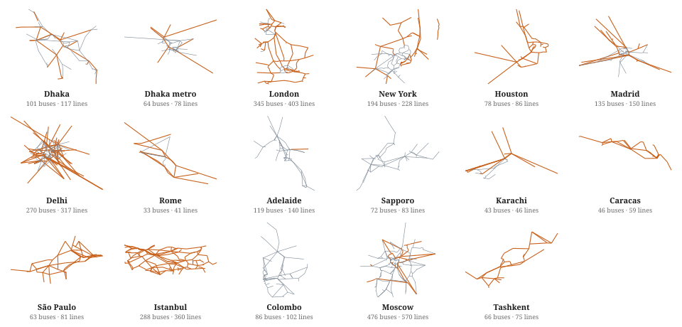
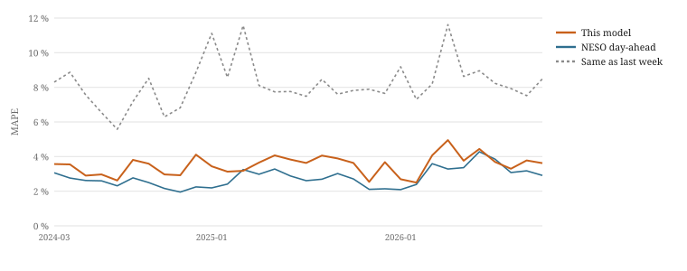
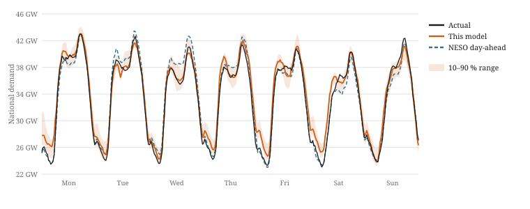
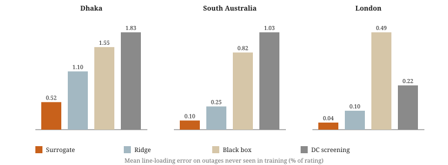
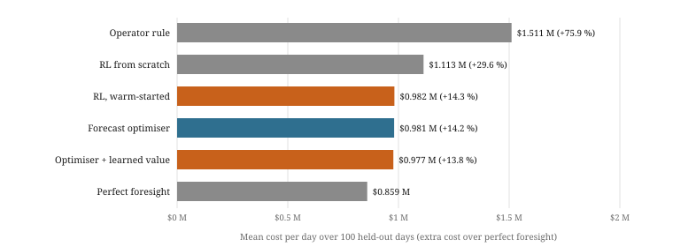
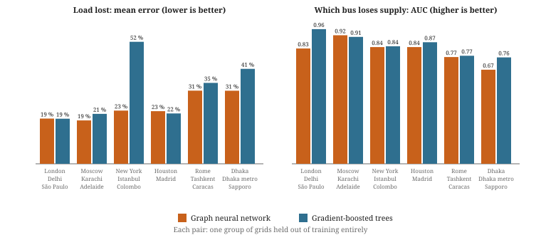
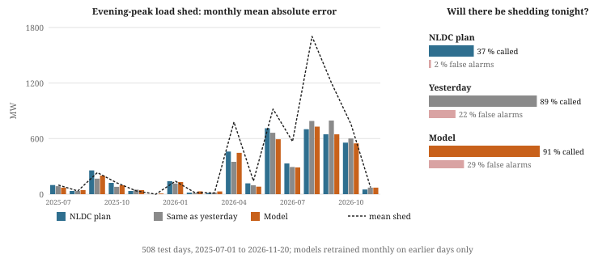

# Tested on What They Have Never Seen: Five Machine-Learning Studies for Power-System Operation on Open, Map-Derived Grids

*Draft, 22 November 2026, with Study E added and references checked the same evening. Author: Talha Yaseer Abeer. Every number and figure in this draft comes from the result files in the repository (see Section 9).*

---

## Abstract

Machine-learning methods for power-system operation are usually evaluated on the same networks and conditions they were trained on, which says little about how they behave when the grid, the contingency or the day is new. We built an open platform: a dynamic simulator with AC power flow, protection and frequency control, running on 17 real transmission grids reconstructed from OpenStreetMap. On it, and on two real operational datasets, we ran five studies, each judged on data its model never saw.

1. **Day-ahead demand forecasting for Great Britain.** A gradient-boosted model was backtested over 46,478 half-hours from March 2024 to October 2026, retrained monthly and fed only the weather forecasts available at the time. It reaches a 3.52 % mean absolute percentage error (MAPE), against 2.79 % for the system operator's (NESO's) published forecast. Averaging the two gives 2.64 %, better than either alone. Conformal calibration raises the coverage of the 10–90 % range from 59 % to 79 %.
2. **A learned AC power flow for N-1 screening.** The network's inputs describe each outage only through classical DC distribution factors, never the line's identity. On outages withheld from training it predicts line loadings with a mean error of 0.04–0.52 % of rating, against 0.22–1.83 % for DC screening. It catches 96–99.6 % of overloads, and screens a full N-1 set 200–770 times faster than the fast decoupled load flow (FDLF).
3. **Reinforcement-learning dispatch for a South-Australia-like grid** under forecast error, on 100 held-out days:
   - PPO trained from scratch costs 29.6 % above the perfect-foresight optimum.
   - Warm-started by imitating hindsight-optimal decisions, the agent statistically ties a rolling-horizon optimiser at about 14 %, while deciding 23 times faster.
   - A learned terminal value of stored energy inside the optimiser gives a small but significant saving: $3.8 k/day, 95 % CI $2.8–4.7 k.
4. **Cascade prediction with a graph neural network (GNN)** on 9,929 simulated cascades across 17 grids, evaluated with every grid held out once. On unseen grids the GNN predicts the share of load lost with 23.7 % mean error, against 31.7 % for gradient boosting on screening features, and major events with an AUC of 0.82 against 0.74. Bus-level boosted trees remain slightly better at naming the substations that lose supply (AUC 0.86 against 0.83).

5. **Same-day load-shedding prediction for Bangladesh** from 690 consecutive daily reports of the national load dispatch centre (NLDC), tested on 508 later days. The operator's own morning plan foresaw shedding on only 37 % of the 335 evenings that had it. Learning adds little on the megawatts: a correction to NLDC's planned figure reduces the mean error from 257 to 242 MW, not significantly, while simply averaging the plan with the previous evening's outcome gives 230 MW (significant, 95 % CI 10–44 MW better). On whether any shedding will happen, the previous evening is already as good as the model (AUC 0.89 against 0.88).

Across the five studies, the gap between in-distribution and out-of-distribution accuracy is large, method-dependent, and invisible without the right test.

---

## 1. Introduction

Operators already rely on fast approximations: DC screening, rule-based dispatch, a forecaster's point estimate. Machine learning promises better approximations, but a model that has only been scored on the grid and conditions it was trained on has not been tested on the property that matters in operation: what happens when something new arrives. That might be a contingency the model never saw, a day unlike the training days, or a network it was not built for.

This work makes that test the centre of the evaluation. Its contributions are:

1. **An open simulation platform** of 17 transmission grids rebuilt from OpenStreetMap.
   - Each grid has an AC power flow (FDLF with a Newton–Raphson reference), governor droop and AGC, under-frequency load shedding, thermal, distance and out-of-step protection, voltage-collapse detection, and an external equivalent for interconnections.
   - It runs in a web browser, so every result can be inspected interactively.
2. **Five studies, each with a held-out test built for its task:** later months for forecasting and for load shedding, withheld outages for power flow, unseen days for dispatch, and unseen grids for cascades.
3. **Physics-informed designs that generalise better than black boxes:**
   - DC distribution factors as the outage encoding for the power-flow surrogate;
   - hindsight imitation as the warm start for reinforcement learning;
   - learned storage values inside an optimiser.
4. **Negative results reported alongside positive ones.** These include a residual RL-on-MPC agent that never beat its starting point, five regularisation strategies that barely moved the GNN's bus-level generalisation, and a load-shedding model that does not significantly beat a two-line average of the operator's plan and yesterday's outcome.

## 2. Related work

**Load forecasting.**
- Probabilistic load forecasting is well surveyed [10].
- The Global Energy Forecasting Competitions (GEFCom) established the benchmarks most methods are now compared on: GEFCom2014 for probabilistic forecasts [11] and GEFCom2017 for hierarchical probabilistic forecasts [12]. Gradient boosting trained on quantiles ranked among the strongest entries, and probabilistic LightGBM remains a competitive recent baseline [13].
- Fewer studies benchmark directly against a transmission operator's own published day-ahead forecast, out of sample, with only the weather forecasts available at the time. That comparison is ours.

**Learned power flow and contingency analysis.**
- Neural surrogates for AC power flow must cope with topology changes, which is exactly what an N-1 study introduces.
- *Guided dropout* encodes the outaged element in the network's structure, and generalises from N-1 to some N-2 cases [14].
- Convolutional regression surrogates have been used for N-1 screening under uncertain injections [15].
- Graph neural networks process topology changes natively [16].
- Recent work repurposes a single base-case model for post-contingency AC states using PTDF-based fixed-point iteration [17].
- Our surrogate follows the same physics-first idea from another direction: classical DC distribution factors are the *only* description of the outage the network receives, and it learns the AC correction. We show this separates generalisation to unseen outages from memorisation of known ones.

**Reinforcement learning against optimisation for dispatch.**
- Comparisons of RL and model predictive control for storage and dispatch are mixed:
  - RL and MPC trade off data efficiency, online computation and robustness [18];
  - RL can match MPC in multi-energy systems given adequate constraint handling and pre-training [19];
  - demonstrations from simple rules can improve RL battery dispatch [20].
- We add a case with realistic forecast error and a perfect-foresight floor. Imitation of hindsight-optimal decisions is what makes RL competitive with MPC, and the only *significant* gain over MPC comes from machine learning placed inside the optimiser, as a learned value of stored energy.

**Supply shortfalls and load shedding.** Most load-forecasting work, including the competitions above, assumes demand is served. In supply-constrained systems the operational question is different: how much demand will *not* be served tonight. We found few published, out-of-sample studies of same-day or day-ahead load-shedding prediction from an operator's own daily reports, and none that scores against the operator's published plan; this needs a proper literature search before submission. Study E is such a test, on Bangladesh's national grid.

**Graph neural networks for cascading failures.**
- GNNs have been used:
  - to predict grid states through each generation of a cascade [21];
  - to transfer node-level cascade centrality from small synthetic networks to larger grids [22];
  - to estimate cascade size [23];
  - and, very recently, to analyse cascades zero-shot on grids unseen in training [24].
- Our contribution to this line is an evaluation in which every one of 17 real, map-derived grids is held out once. It measures graph-level size and severity separately from bus-level outcomes, against strong tree-based baselines at both levels. The GNN transfers best at the graph level, while per-bus trees remain stronger at naming the buses that lose supply on a new grid.

## 3. Platform

### 3.1 Grids from OpenStreetMap

A build pipeline queries OpenStreetMap through the Overpass API for each region and assembles a single-line model:
- **Network:** power lines, cables, substations and plants above a minimum voltage. HVDC ways are excluded.
- **Line parameters:** reactance, resistance, charging and thermal ratings estimated per voltage class and circuit count.
- **Demand:** spread from population to the three nearest substations, capped at 45 % of the incident line capacity.

Seventeen grids were built: Adelaide, Caracas, Colombo, Delhi, Dhaka, Dhaka metro, Houston, Istanbul, Karachi, London, Madrid, Moscow, New York, Rome, São Paulo, Sapporo and Tashkent. They range from 33 to 345 buses.

Where mapping is incomplete, per-region options correct the model:
- series compensation;
- must-run units;
- extra lines that exist but are not mapped;
- demand correction areas.

Each correction is documented in the configuration file.

### 3.2 Simulator

The simulator advances in steps of 0.05–0.1 s:
- **Swing equation:** one per electrical island, with inertia from synchronous machines.
- **Frequency control:** governor droop and automatic generation control (AGC).
- **AC power flow:** FDLF every 0.25 s, warm-started; if the first solution fails, a Newton–Raphson solve provides the initial operating point.
- **Voltage control:** switched shunts, with reactors and capacitors moved toward the 0.97–1.05 pu band.
- **Protection:** thermal, distance, out-of-step, generator voltage and undervoltage load shedding.
- **Frequency-triggered actions:** rooftop solar trips on fast rate of change of frequency (RoCoF); load shedding in steps from 48.8 Hz; island collapse below 47.5 Hz.
- **Interconnection:** an external equivalent represents the wider system, as AC ties or an HVDC link.

The same simulator replays 24 historical blackouts in the accompanying web application.

---

## 4. Study A: day-ahead demand forecasting (Great Britain)

### 4.1 Data and protocol

- **Demand:** GB national demand outturn, eight years at half-hour resolution, with NESO's published day-ahead forecast as the benchmark.
- **Weather:** ten population-weighted cities. Historical values come from ERA5; for the backtest we used the previous-run day-ahead forecasts that would have been available at the time, not observed weather.
- **Calendar:** bank holidays and the Christmas period.
- **Model:** LightGBM, retrained each month on all earlier data, then used to forecast that month a day ahead.
- **Uncertainty:** 10 % and 90 % quantile models give a range, widened by conformalised quantile regression. The widening uses only scores from earlier test months, so no future data leaks in.

### 4.2 Results

Test period: 6 March 2024 to 30 October 2026, 46,478 half-hours.

| Forecast | MAPE | MAE |
|---|---|---|
| Naive: same half-hour a week earlier | 8.20 % | 2,063 MW |
| This model | 3.52 % | 870 MW |
| NESO day-ahead | 2.79 % | 690 MW |
| Average of model and NESO | **2.64 %** | — |

| 10–90 % range | Coverage (target 80 %) | Mean width |
|---|---|---|
| Raw quantile models | 59.4 % | 1,985 MW |
| After conformal calibration | 78.8 % | 2,878 MW |

The model does not beat the operator, which has richer inputs (embedded-generation metering and operator judgement). But its errors are different enough that averaging the two beats both. The raw quantile range is too narrow because the models were trained on observed weather and run on forecast weather; conformal calibration corrects most of that gap.

---

## 5. Study B: a learned AC power flow for N-1 screening

### 5.1 Problem

Each grid is settled once in the simulator to fix its base case. Samples then redraw:
- the operating point: system load from 55 to 145 %, per-bus lognormal noise (σ = 0.15), a fresh dispatch of every plant, and inverter output from 0 to 100 %;
- the topology: in 75 % of samples, one line is taken out. Lines whose loss would island part of the grid are excluded.

The FDLF, warm-started from the base case, labels each sample with every bus voltage, every line loading and whether it converged. That gives 30,000 samples per grid, on Dhaka (101 buses), South Australia (119) and London (339).

### 5.2 Model

- **Inputs:** bus active and reactive injections, plus the DC post-contingency loading of every line, computed from PTDF and LODF factors. The outage is described only through these DC loadings; the line's identity is never given.
- **Outputs:** every bus voltage, and the AC correction to every DC loading (a residual), plus a logit for whether the case converges.
- **Network:** three hidden layers of 256 units.

### 5.3 Evaluation

Two test sets:
- random hold-out samples;
- **unseen contingencies:** 20 % of the N-1 lines are never taken out in training.

Baselines:
- DC screening alone;
- ridge regression on the same inputs;
- the same network given a one-hot code of the outaged line ("black box");
- the average state.

### 5.4 Results

Mean error on line loading, as a percentage of the line's rating:

| Unseen contingencies | Dhaka | South Australia | London |
|---|---|---|---|
| **Surrogate (DC features + residual)** | **0.52 %** | **0.10 %** | **0.04 %** |
| Ridge regression | 1.10 % | 0.25 % | 0.10 % |
| Black box (one-hot outage) | 1.55 % | 0.82 % | 0.49 % |
| DC screening | 1.83 % | 1.03 % | 0.22 % |
| Overloads caught, surrogate | 96 % | 99.6 % | (none occur) |
| Overloads caught, DC screening | 71 % | 99.9 % | (none occur) |
| Voltage error, surrogate | 0.0033 pu | 0.0016 pu | 0.0004 pu |

Speed, measured in Python on one CPU core with the whole N-1 set evaluated as one batch:

| | Dhaka | South Australia | London |
|---|---|---|---|
| Contingencies screened | 60 | 87 | 309 |
| Surrogate | 0.37 ms | 0.39 ms | 2.0 ms |
| FDLF | 78 ms | 73 ms | 1,564 ms |

**Findings:**
- **The one-hot network memorises line identities.** It does worse on new outages than plain linear regression.
- **Describing the outage physically is what lets the network generalise.** The DC encoding plus a learned AC correction beats both linear regression and the black box.
- **Limitations:**
  - The convergence head does not generalise to unseen outages: AUC 0.44 in Dhaka, i.e. chance level.
  - Voltage is learned less well than loading on unseen outages.
  - London's mapped grid never overloads in our sampling, so overload recall is undefined there.

---

## 6. Study C: reinforcement-learning dispatch under forecast error

### 6.1 Environment

South Australia is modelled as one node, dispatched every half hour.

| Component | Size |
|---|---|
| Wind | 2,730 MW (curtailable) |
| Solar farms | 450 MW (curtailable) |
| Rooftop solar | 2,400 MW installed (curtailable only by an emergency backstop) |
| Combined-cycle gas | 1,300 MW, ramp 250 MW per half hour |
| Open-cycle gas | 2,100 MW |
| Oil | 181 MW |
| Battery fleet | 600 MW / 750 MWh |
| Heywood interconnector | 650 MW import, 500 MW export, at the Victorian price |

At least 300 MW of synchronous generation must stay online for system strength.

Each half hour, every dispatcher sets the combined-cycle target, the battery and the interconnector from forecasts. Forecast errors grow with lead time: about 35 MW for demand and 90 MW for renewables half an hour ahead. The real values then arrive, and the same balancing rule applies to every dispatcher:
- open-cycle gas and oil cover any shortfall, and renewables are curtailed on any surplus;
- the last resorts are the rooftop backstop at $600/MWh and unserved energy at $15,000/MWh.

Days are synthetic, calibrated to published South Australian ranges.

### 6.2 Dispatchers

1. **Operator rule:** a hand-written heuristic.
2. **MPC:** a 4-hour HiGHS linear programme over the forecasts, re-solved every half hour.
3. **MPC with a learned value of stored energy:**
   - a LightGBM model predicts the shadow price (dual) of stored energy at the end of the MPC window;
   - it is trained on duals from 4,000 perfect-foresight solutions;
   - the prediction replaces the fixed terminal value.
4. **PPO from scratch:** 400 rounds of 256 simulated days.
5. **PPO warm-started:**
   - behaviour cloning of perfect-foresight decisions, using inputs available at the time only;
   - then 1,400 rounds of PPO fine-tuning, with a critic warm-up and small exploration noise;
   - checkpoints chosen on 100 separate validation days.
6. **Perfect foresight:** one whole-day linear programme with the actual values. This is the lower bound on cost.

### 6.3 Results

100 held-out test days; intervals from a paired bootstrap against MPC.

| Dispatcher | Cost per day | Above the floor | vs MPC, $k per day [95 % CI] | Days better than MPC | Decision time |
|---|---|---|---|---|---|
| Operator rule | $1.511 M | +75.9 % | | 0 | 0.1 ms |
| PPO from scratch | $1.113 M | +29.6 % | | 0 | 0.16 ms |
| PPO warm-started | $0.982 M | +14.3 % | −1.1 [−6.9, +4.9] | 46 | 0.15 ms |
| MPC | $0.981 M | +14.2 % | — | — | 3.4 ms |
| **MPC + learned storage value** | **$0.977 M** | **+13.8 %** | **+3.8 [+2.8, +4.7]** | **80** | 6.8 ms |
| Perfect foresight | $0.859 M | floor | | | |

**Findings:**
- **Imitating hindsight is what makes RL competitive here.** From scratch, PPO stalls at nearly 30 % above the floor; warm-started, it ties MPC while deciding 23 times faster.
- **Machine learning inside the optimiser gives the only significant improvement over MPC.** The learned storage value saves $3.8 k a day.
- **A residual agent on top of MPC never beat its starting point** in 130 training rounds. We report this as a negative result.
- **Most of the remaining gap is forecast error.** Perfect foresight dispatches 3 MWh a day of open-cycle gas; the forecast-driven dispatchers need 700–860 MWh. Better forecasts would be worth more than a better dispatcher.

---

## 7. Study D: cascade prediction with a graph neural network

### 7.1 Data

9,929 cascades on the 17 grids, from 400 to 1,280 per grid. Each sample:
- **sets conditions:** a load level (75–120 %), the effectiveness of load shedding, and the share of generation that responds to frequency;
- **takes a snapshot** of the grid as a graph;
- **applies a contingency:** one to four line trips (biased toward loaded lines), sometimes the largest plant, sometimes the external tie;
- **runs the simulator for 90 s.**

Labels:
- the share of load lost, which exceeds 10 % (a major event) in 44.9 % of samples;
- for every bus, whether it lost supply.

### 7.2 Model and baselines

- **GNN:** six message-passing layers with edge features, hidden size 96.
  - Node inputs: voltage class, load, generation, headroom, voltage, angle, degree, external tie, tripped plant, and 1/(1 + hops to the fault).
  - Edge inputs: reactance, rating, loading, voltage class, circuits, and a tripped flag.
  - A graph head reads mean and max pooling plus 15 screening features.
  - A bus head reads each bus's embedding together with the pooled event summary.
  - Training: binary cross-entropy at both levels, 15 epochs.
- **Graph-level baseline:** LightGBM on the 15 screening features.
- **Bus-level baselines:** hops from the fault, and LightGBM on per-bus features plus hops and the screening features.
- **Hybrid:** the average of GNN and bus-level LightGBM probabilities.

**Protocol:**
- a random 80/20 split;
- **leave-grids-out:** six groups, every grid held out once. Dhaka and its metro sub-grid share buses, so they are held out together.
- 3 seeds for the GNN.

### 7.3 Results

**Unseen grids** (predictions pooled over all six folds):

| Model | MAE of load lost | Major-event AUC | Spearman | Bus AUC |
|---|---|---|---|---|
| Average loss (no model) | 39.8 % | 0.38 | −0.21 | — |
| Hops from the fault | — | — | — | 0.670 |
| LightGBM, screening features | 31.6 % | 0.735 | 0.46 | — |
| LightGBM, bus by bus | — | — | — | **0.860** |
| **GNN** | **23.7 % ± 1.7** | **0.821** | **0.60** | 0.831 |
| GNN + bus trees, averaged | — | — | — | 0.851 |

**Same grids, new cases:**
- GNN: 7.8 % MAE, major-event AUC 0.970, bus AUC 0.984.
- LightGBM: 11.9 % MAE, major-event AUC 0.953; bus by bus, AUC 0.966.

**Per fold (unseen):**

| Held-out grids | GNN MAE | Trees MAE | GNN bus AUC | Bus-trees AUC |
|---|---|---|---|---|
| London, Delhi, São Paulo | 19.4 % | 19.4 % | 0.83 | 0.96 |
| Moscow, Karachi, Adelaide | 18.7 % | 21.4 % | 0.92 | 0.91 |
| New York, Istanbul, Colombo | 22.9 % | **52.4 %** | 0.84 | 0.84 |
| Houston, Madrid | 22.6 % | 21.6 % | 0.84 | 0.87 |
| Rome, Tashkent, Caracas | 31.4 % | 34.8 % | 0.77 | 0.77 |
| Dhaka, Dhaka metro, Sapporo | 31.4 % | 40.8 % | 0.67 | 0.76 |

**Ablations** (first fold only, one seed; ✓ marks the setting kept):

| Change | Bus AUC |
|---|---|
| Base | 0.800 |
| Dropout 0.2 | 0.817 |
| Weight decay ×100 | 0.800 |
| 15 epochs ✓ | 0.835 |
| 3 layers | 0.746 |
| All regularisers combined | 0.795 |

Making the features grid-independent (loads relative to the grid's average, angle differences instead of absolute angles) gave 0.829. On the random split, two design changes raised bus AUC from 0.942 to 0.987:
- adding the hop feature and an equal node-loss weight;
- letting the bus head read the pooled summary.

**Findings:**
- **On unseen grids the GNN is the more robust predictor of event size and severity.** In one fold, the boosted trees' estimate collapses to 52 % error while the GNN's stays at 23 %.
- **Bus-level transfer remains the per-bus trees' edge,** and regularisation narrowed the gap only slightly.
- **Every method degrades substantially out of distribution.**

---

## 8. Study E: same-day load-shedding prediction (Bangladesh)

### 8.1 Data

Power Grid Bangladesh PLC publishes a daily operation report from its National Load Dispatch Centre [25]. We downloaded and parsed every report in spreadsheet form: 690 consecutive days, 31 December 2024 to 20 November 2026, with no gaps. Each gives:
- **the day's actuals:** evening-peak load shed and demand for each of nine zones, peak and minimum generation, energy served and not served, the fuel mix, imports, gas delivered to power plants and the maximum temperature;
- **the plan for the next day:** forecast peak demand and generation, forecast temperature, and planned load shedding by zone;
- **a plant-by-plant table** of present capacity, expected availability and the reason for any shortfall ("gas shortage", "liquid fuel shortage", maintenance), which we aggregate into megawatts out by reason.

Reports up to 22 January 2025 state energy in MWh rather than GWh; the parser detects and rescales them.

Shedding is frequent and uneven. It occurred at the evening peak on 424 of the 690 days, exceeded 1,000 MW on 75, and peaked at 3,047 MW. From April 2026 it surged: the monthly mean rose from about 100 MW in 2025 to 1,704 MW in August 2026.

### 8.2 Information set and protocol

The report for day D is issued at about 11:00 on D+1, together with the plan for D+1. A forecast for day D therefore sees actuals up to D−1, NLDC's plan for D, and the calendar (weekend, Ramadan, Eid). That is exactly what NLDC itself knew when it made its plan.

- **Target:** load shed at the evening-peak hour (substation end, MW), national and for each zone.
- **Protocol:** expanding window; retrained at the start of each month on all earlier days and tested on that month, from July 2025 to November 2026 (508 days, 335 with shedding, 74 above 1,000 MW).
- **Baselines:** NLDC's planned shed; persistence (the previous evening); the 7-day mean; and the average of NLDC's plan and persistence, which needs no learning.
- **Model:** LightGBM with a Huber loss, predicting the *correction* to NLDC's planned figure, from 77 inputs; separate classifiers for any shedding and for more than 1,000 MW.
- **Intervals:** paired moving-block bootstrap with 7-day blocks.

A direct model of the megawatts (Tweedie loss) did worse, at 274 MW: in April and August 2026 it met shedding deeper than anything in its training data and could not extrapolate. Predicting a correction to the operator's plan avoids that, since the plan already moves with the regime. A residual on persistence (244 MW), ridge regression (253 MW) and the plant-outage features changed little.

### 8.3 Results

| Forecast | MAE | RMSE | vs NLDC, MW [95 % CI] |
|---|---|---|---|
| NLDC's planned shed | 257 MW | 498 MW | — |
| Persistence (previous evening) | 252 MW | 511 MW | |
| 7-day mean | 296 MW | 519 MW | |
| Model (correction to NLDC) | 242 MW | 465 MW | −14.7 [−30.4, +0.3] |
| NLDC and persistence, averaged | 230 MW | 454 MW | −27.3 [−44.2, −10.4] |
| **Model, NLDC and persistence, averaged** | **227 MW** | **443 MW** | **−29.5 [−44.7, −15.9]** |

The three-way average beats the two-way average by only 2.3 MW (95 % CI −8.6 to +3.6). In the surge months (183 days in months with a mean above 500 MW) every error is large: 568 MW for NLDC and 520 MW for the three-way average, against 82 and 63 MW in the calm months.

Will there be any shedding at the evening peak?

| Forecaster | Shedding evenings called | False alarms on quiet evenings | AUC |
|---|---|---|---|
| NLDC's plan | 37 % | 2 % | 0.68 |
| Persistence | 89 % | 22 % | 0.89 |
| Model | 91 % | 29 % | 0.88 |

For severe evenings (above 1,000 MW) the order reverses: NLDC's plan names 70 % of them, persistence 68 % and the classifier 42 %, at 3–6 % false alarms.

**Findings:**
- **The operator's plan is conservative about occurrence but informative about depth.** It rarely plans shedding that does not happen, misses most evenings that do have it, and is the best guide to the severe ones.
- **Persistence is a strong baseline that the plan does not use.** Averaging the two, with no learning, cuts the error by 11 %, significantly.
- **Learning adds little beyond that.** The inputs the model uses most are the previous evening's shed, NLDC's plan and the previous evening's shortfall. Day-to-day shedding is driven by fuel deliveries and plant trips that the morning report does not foresee.
- **Limitations:** two years of data, with most deep shedding in one season; NLDC's planned figure is a schedule, not necessarily a best estimate; shedding is reported at the substation end and may understate what consumers experience.

---

## 9. Threats to validity and reproducibility

**Threats to validity:**
- **Labels come from a simulator, not real events.** Studies B–D measure how well models learn the simulator's physics. The simulator's protection is simplified: no relay coordination studies, and no operator action inside 90 s.
- **The grids are map-derived.** Their parameters are estimated, and mapping completeness varies between regions.
- **The dispatch days are synthetic.**
- **Studies A and E use real operational data throughout;** Study E has only two years, with most deep shedding in one season.

**Reproducibility:** the repository contains every script.

| Study | Script | Generated data | Exported results |
|---|---|---|---|
| A | `ml/fetch_neso.py`, `ml/fetch_weather.py`, `ml/forecast.py`, `ml/calibrate.py`, `ml/export.py` | — | `public/data/forecast/` |
| B | `ml/surrogate.py` | `src/ai/surrogate-data.test.ts` | `public/data/surrogate/` |
| C | `ml/dispatch.py`, `ml/dispatch_finetune.py`, `ml/dispatch_eval.py` | — | `public/data/dispatch/sa.json` |
| D | `ml/gnn.py`, `ml/gnn_gen.py` | `src/ai/cascade-data.test.ts` | `public/data/cascade/gnn.json` |
| E | `ml/fetch_pgcb.py`, `ml/parse_pgcb.py`, `ml/loadshed.py` | — | `public/data/loadshed/bd_backtest.json` |

Each trained model runs in the browser, and a test checks it against the Python original.

**Hardware:** one laptop with an 8-core CPU and an RTX 5060 GPU (8 GB). The slowest single training run was the cascade study, at 25 minutes for 3 seeds over seven splits.

## 10. Conclusion

Five operational tasks, five held-out tests. In every case the in-distribution score overstated what the model would do on something new, and by different amounts for different methods. The methods that held up best encoded the physics rather than the identity of the thing they had seen:
- DC distribution factors instead of line identities;
- imitation of hindsight-optimal decisions;
- a learned value of stored energy inside an optimiser;
- message passing over the network's own structure.

The real-data load-shedding study adds a sobering counterpoint: when the operator's plan and yesterday's outcome are both available, a two-line average captures most of what a learned model can, and the useful contribution is to show that simple gain.

**Future work:**
- real disturbance records for validation;
- multi-outage power-flow surrogates;
- topology-robust bus-level cascade prediction;
- real-data dispatch on recorded South Australian days;
- longer load-shedding histories, and fuel-delivery data (LNG cargoes, gas-field output) as inputs.

---

## References

[1] B. Stott and O. Alsac, "Fast decoupled load flow," *IEEE Trans. Power Apparatus and Systems*, vol. PAS-93, no. 3, pp. 859–869, 1974.

[2] A. J. Wood, B. F. Wollenberg and G. B. Sheblé, *Power Generation, Operation, and Control*, 3rd ed. Wiley, 2013.

[3] G. Ke et al., "LightGBM: A highly efficient gradient boosting decision tree," in *Advances in Neural Information Processing Systems 30*, 2017.

[4] Y. Romano, E. Patterson and E. Candès, "Conformalized quantile regression," in *Advances in Neural Information Processing Systems 32*, 2019.

[5] J. Schulman, F. Wolski, P. Dhariwal, A. Radford and O. Klimov, "Proximal policy optimization algorithms," arXiv:1707.06347, 2017.

[6] J. Gilmer, S. S. Schoenholz, P. F. Riley, O. Vinyals and G. E. Dahl, "Neural message passing for quantum chemistry," in *Proc. ICML*, 2017.

[7] Q. Huangfu and J. A. J. Hall, "Parallelizing the dual revised simplex method," *Mathematical Programming Computation*, vol. 10, pp. 119–142, 2018.

[8] H. Hersbach et al., "The ERA5 global reanalysis," *Quarterly Journal of the Royal Meteorological Society*, vol. 146, pp. 1999–2049, 2020.

[9] OpenStreetMap contributors, OpenStreetMap, https://www.openstreetmap.org, data under the Open Database Licence.

[10] T. Hong and S. Fan, "Probabilistic electric load forecasting: A tutorial review," *International Journal of Forecasting*, vol. 32, no. 3, pp. 914–938, 2016.

[11] T. Hong, P. Pinson, S. Fan, H. Zareipour, A. Troccoli and R. J. Hyndman, "Probabilistic energy forecasting: Global Energy Forecasting Competition 2014 and beyond," *International Journal of Forecasting*, vol. 32, no. 3, pp. 896–913, 2016.

[12] T. Hong, J. Xie and J. Black, "Global energy forecasting competition 2017: Hierarchical probabilistic load forecasting," *International Journal of Forecasting*, vol. 35, no. 4, pp. 1389–1399, 2019.

[13] N. Rubattu, G. Maroni and G. Corani, "Electricity load and peak forecasting: Feature engineering, probabilistic LightGBM and temporal hierarchies," arXiv:2305.05575, 2023.

[14] B. Donnot, I. Guyon, M. Schoenauer, A. Marot and P. Panciatici, "Fast power system security analysis with guided dropout," in *Proc. European Symposium on Artificial Neural Networks (ESANN)*, Bruges, Belgium, Apr. 2018; arXiv:1801.09870.

[15] Y. Du, F. Li, J. Li and T. Zheng, "Achieving 100x acceleration for N-1 contingency screening with uncertain scenarios using deep convolutional neural network," *IEEE Trans. Power Systems*, vol. 34, no. 4, pp. 3303–3305, Jul. 2019, doi: 10.1109/TPWRS.2019.2914860.

[16] A. M. Nakiganda and S. Chatzivasileiadis, "Graph neural networks for fast contingency analysis of power systems," arXiv:2310.04213, 2023 (v3, 2025).

[17] M. O. Rahman, J. Qin and V. Kekatos, "AC power flow contingency analysis using a single deep neural network," arXiv:2609.30859, 2026.

[18] M. F. El Hajj Chehade, Y.-h. Cho, S. Chinchali and H. Zhu, "Should we use model-free or model-based control? A case study of battery management systems," arXiv:2407.15313, 2024.

[19] G. Ceusters, R. Cantú Rodríguez, A. Bouso García, R. Franke, G. Deconinck, L. Helsen, A. Nowé, M. Messagie and L. Ramirez Camargo, "Model-predictive control and reinforcement learning in multi-energy system case studies," *Applied Energy*, vol. 303, art. 117634, 2021; arXiv:2104.09785.

[20] M. Sage, M. Staniszewski and Y. F. Zhao, "Economic battery storage dispatch with deep reinforcement learning from rule-based demonstrations," in *Proc. IEEE ICCAD*, 2023, doi: 10.1109/ICCAD57653.2023.10152299; arXiv:2504.04326.

[21] S. Chadaga, X. Wu and E. Modiano, "Power failure cascade prediction using graph neural networks," in *Proc. IEEE SmartGridComm*, Glasgow, UK, 2023, pp. 1–7; arXiv:2404.16134.

[22] B. Jhun, H. Choi, Y. Lee, J. Lee, C. H. Kim and B. Kahng, "Prediction and mitigation of nonlocal cascading failures using graph neural networks," *Chaos*, vol. 33, art. 013115, 2023, doi: 10.1063/5.0107420.

[23] T. Chen, Z. Guo, P. Wang, K. Sun, J. Dong and B. Liu, "Prediction of cascading failure size using a graph neural network with dynamic weights," *IEEE PES General Meeting*, 2026 (paper PESGM2026-000889).

[24] T. Zhou, X. Li and H. Lu, "Inductive power grid cascading failure analysis with GRU-gated graph attention," arXiv:2605.07010, 2026.

[25] Power Grid Bangladesh PLC, National Load Dispatch Centre, "Daily operation report," https://erp.powergrid.gov.bd (reports for 31 December 2024 to 20 November 2026, accessed 22 November 2026).

*References [13]–[24] were checked on 22 November 2026 against arXiv metadata and publisher or repository records (IEEE, AIP, Elsevier via RePEc, MIT DSpace, NSF PAR, the PESGM 2026 paper index).*
